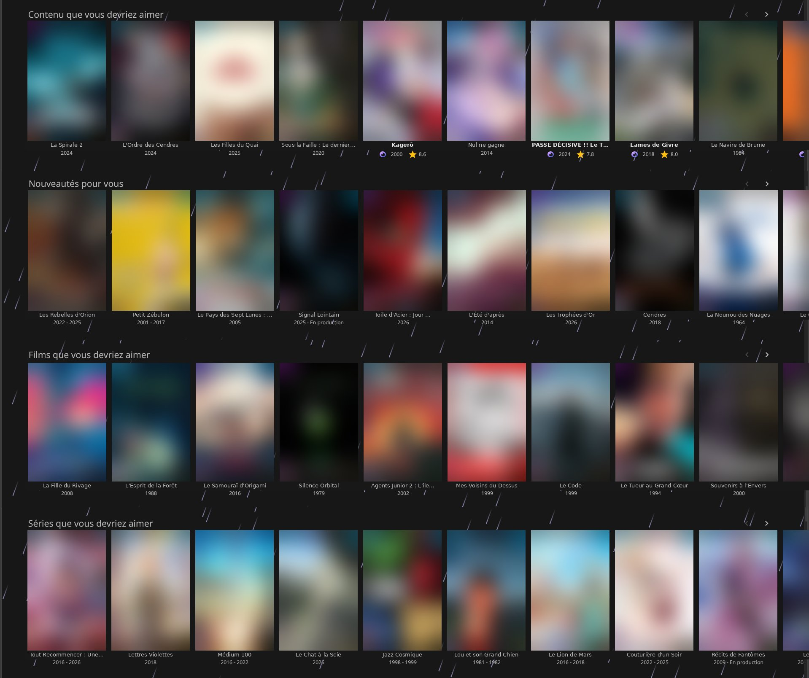
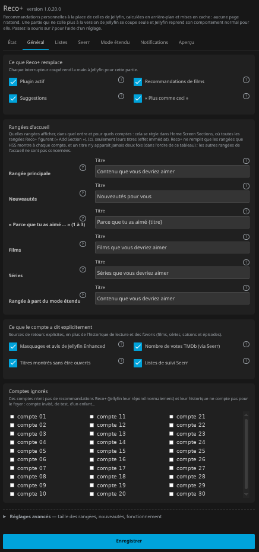
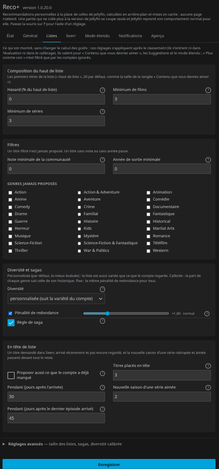
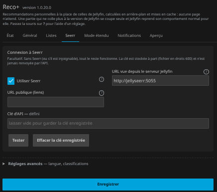
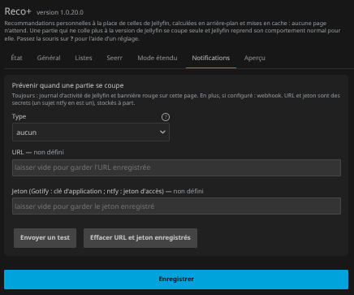

<p align="center"></p>

<h1 align="center">Reco+ — moteur de recommandations pour Jellyfin</h1>

<p align="center"><b>Des recommandations personnalisées pour Jellyfin, façon Netflix, calculées sur tout l'historique de chaque compte.</b></p>

<p align="center">
  <a href="https://github.com/crocodile13/jellyfin-plugin-recoplus/releases/latest"></a>
  <a href="https://github.com/crocodile13/jellyfin-plugin-recoplus/actions/workflows/ci.yml"></a>
  
  <a href="LICENSE"></a>
</p>

<p align="center"><i><a href="README.md">English version</a></i></p>

**Les recommandations intégrées de Jellyfin sont surtout du hasard.** Reco+ les remplace par des listes classées pour chaque personne d'après tout ce qu'elle a regardé, aimé, abandonné ou demandé — et ajoute un accueil façon Netflix, avec des rangées « Pour toi », « Parce que tu as aimé … », tendances et nouveautés. Avec Seerr, il propose même des titres que vous n'avez pas encore, avec un bouton *Demander*.

<p align="center">
  
  <br><sub>Un accueil avec les rangées Reco+ : jamais deux fois le même titre, et la première rangée mêle des titres que vous n'avez pas encore (cartes Seerr de Jellyfin Enhanced).</sub>
</p>

## Pourquoi Reco+

| | Jellyfin seul | Avec Reco+ |
|---|---|---|
| **Suggestions** | des titres au hasard | vos titres, classés selon vos goûts |
| **« Parce que vous avez regardé X »** | les 7 derniers films seulement | tout votre historique, films et séries |
| **« Plus comme ceci »** | genres en commun pour les films, séries au hasard | vraie ressemblance de contenu, le volet suivant d'une saga en premier |
| **Accueil** | ajouts récents, reprendre | jusqu'à 10 rangées personnelles, jamais deux fois le même titre |
| **Titres que vous n'avez pas** | — | proposés d'après vos goûts, demandés en un clic (facultatif, avec Seerr) |
| **Mesuré sur un vrai serveur** — le titre commencé ensuite était dans le top 10 juste avant | 11 % | **18–19 %** |

## Comment ça marche, en 30 secondes

1. **Votre historique devient un goût.** Chaque titre vu, abandonné, noté, aimé, masqué ou demandé reçoit un poids ; les anciens comptent moins, les abandons pèsent contre les titres semblables.
2. **Chaque titre que vous n'avez pas vu reçoit un score** selon sa ressemblance à vos goûts — genres, mots-clés, réalisateur, acteurs… — et ce que regardent les gens aux goûts proches dans votre foyer.
3. **Un garde-fou** : nouveauté, popularité et notes n'aident que les titres qui vous correspondent *déjà*. Un titre neuf ou populaire qui n'est pas pour vous n'est jamais poussé.
4. **Vos rangées sont composées** : diversité, une seule entrée par saga (le premier volet pas encore vu), les nouveaux épisodes de ce que vous suivez d'abord, aucun doublon entre rangées.

Tout est calculé en arrière-plan : aucune page n'attend. L'explication complète, avec chaque formule, est dans le **[wiki](https://github.com/crocodile13/jellyfin-plugin-recoplus/wiki/Accueil-fr)**.

## Installation

### Par le dépôt de plugins (recommandé)

1. Dans **Tableau de bord → Extensions → Dépôts**, ajoutez :
   ```
   https://raw.githubusercontent.com/crocodile13/jellyfin-plugin-recoplus/main/manifest.json
   ```
2. Installez **Reco+** depuis le catalogue.
3. Redémarrez Jellyfin.

Les nouvelles versions sont ensuite installées par la tâche planifiée **Mettre à jour les extensions** de Jellyfin (Tableau de bord → Tâches planifiées) et appliquées au redémarrage suivant.

### À la main

1. Téléchargez `RecoPlus_<version>.zip` depuis les [releases](https://github.com/crocodile13/jellyfin-plugin-recoplus/releases) et vérifiez-le avec le `.sha256` publié.
2. Décompressez-le dans `<config>/plugins/RecoPlus_<version>/`, propriété de l'utilisateur de Jellyfin.
3. Redémarrez Jellyfin.

## Premiers pas

1. Ouvrez **Reco+** dans le menu du tableau de bord (section Extensions). Les valeurs par défaut sont celles qui ont été évaluées : il marche dès l'installation.
2. Dans l'onglet **État**, cliquez sur **Recalculer maintenant**.
3. Avec Home Screen Sections, cliquez sur **Les ajouter pour moi** dans l'onglet État ; titres et contenus des rangées se règlent dans l'onglet **Accueil**.
4. Avec Seerr, saisissez son URL et sa clé d'API dans l'onglet **Seerr**, cliquez sur **Tester**, puis activez le **Mode étendu** pour les titres que vous n'avez pas.
5. Voyez exactement ce que reçoit un compte dans l'onglet **Aperçu** : ses rangées en affiches, avec la raison de chaque titre.

Les réglages ont trois niveaux — **essentiels** (par défaut), **avancés**, **experts** — à choisir à droite des onglets. Survolez le **?** à côté d'un réglage pour son aide.

## Fonctionnalités

- **Partout où Jellyfin recommande** : Suggestions, « Parce que vous avez regardé », « Plus comme ceci », la Media Bar.
- **Rangées d'accueil** avec [Home Screen Sections](https://github.com/IAmParadox27/jellyfin-plugin-home-sections) : « Pour toi », « Tendances », « Populaires », « À venir », « Nouveautés pour toi », jusqu'à trois « Parce que tu as aimé … », « Films pour toi », « Séries pour toi ». Chaque rangée : films, séries, les deux, ou séparée en deux.
- **Écoute tout ce que vous exprimez** : favoris (série, saison ou épisode), notes, avis et titres masqués de Jellyfin Enhanced, demandes et liste de suivi Seerr, titres montrés sans être ouverts.
- **Titres que vous n'avez pas** (mode étendu, facultatif) : trouvés d'après vos goûts dans le catalogue TMDb, classés par le même moteur, avec un curseur d'**audace des découvertes**, de prudente à aventureuse.
- **Dit pourquoi** : sur la fiche d'un titre ouvert depuis une rangée Reco+, une ligne discrète l'explique (« Parce que tu as aimé X », « Suite de X », « Nouveaux épisodes »…).
- **Sûr** : les droits d'accès et le contrôle parental de Jellyfin s'appliquent à chaque liste ; rien n'est jamais demandé automatiquement.
- **Mesuré, pas deviné** : l'onglet État montre ce que les comptes font de ce qui leur est recommandé (commencé sous 7 jours, fini sous 30), et le **Calibrage** règle le moteur sur votre propre historique — en ne proposant que ce qui se généralise vraiment.
- **Se protège seul** : chaque point d'accroche de Jellyfin est vérifié au démarrage ; une partie qui ne colle plus se coupe, avec une alerte.
- **Français, anglais, allemand et espagnol**, selon la langue Jellyfin de chacun.

## Captures d'écran

<table>
  <tr>
    <td width="50%" valign="top"><br><sub><b>Général</b> — ce que Reco+ remplace, titres des rangées, retours explicites, comptes ignorés.</sub></td>
    <td width="50%" valign="top"><br><sub><b>Listes</b> — ce qui est montré : hasard, minimums, filtres, diversité, sagas, titres en tête.</sub></td>
  </tr>
  <tr>
    <td width="50%" valign="top"><br><sub><b>Seerr</b> — test de connexion ; la clé est stockée à part et jamais renvoyée.</sub></td>
    <td width="50%" valign="top"><br><sub><b>Notifications</b> — webhook quand une partie se coupe d'elle-même.</sub></td>
  </tr>
</table>

<sub>Interface en français, anglais, allemand et espagnol (captures en français). Captures de la version 1.0.20 sur un vrai serveur : noms des comptes remplacés, affiches floutées, titres inventés.</sub>

<sub>PS : la pluie n'est pas une fonctionnalité de Reco+. C'est un délire perso de l'instance de « prod » de l'auteur, sur laquelle ces captures ont été prises. Le plugin recommande des films, il ne fait pas la météo.</sub>

## Prérequis

- **Jellyfin 12.2 à 12.4** (les autres versions sont détectées et chaque point d'accroche est vérifié, mais elles ne sont pas testées).
- Facultatif, chacun ajoute quelque chose et rien ne casse sans lui :

| Plugin / service | Ce qu'il apporte |
|---|---|
| [Home Screen Sections](https://github.com/IAmParadox27/jellyfin-plugin-home-sections) | les rangées d'accueil (c'est lui qui décide quelles rangées chaque compte voit, et dans quel ordre) |
| [Seerr](https://github.com/seerr-team/seerr) (Jellyseerr / Overseerr) | demandes et listes de suivi comme goûts, rangées tendances / populaires / à venir, titres que vous n'avez pas (mode étendu) |
| [Jellyfin Enhanced](https://github.com/n00bcodr/Jellyfin-Enhanced) | avis en étoiles et titres masqués ; ses cartes et son bouton *Demander* pour les titres que vous n'avez pas |
| [Playback Reporting](https://github.com/jellyfin/jellyfin-plugin-playbackreporting) | dates de premier lancement précises, pour le calibrage |
| [Media Bar Enhanced](https://github.com/IAmParadox27/jellyfin-plugin-media-bar) | montre les recommandations Reco+ avec son option « Personalized Recommendations » |

LocalRecs, s'il est installé, fait doublon : mieux vaut le désinstaller.

## Questions fréquentes

**Pourquoi les recommandations de Jellyfin semblent-elles au hasard ?** `/Items/Suggestions` renvoie des titres au hasard, « Parce que vous avez regardé » ne regarde que les derniers films, et « Plus comme ceci » prend des séries au hasard qui partagent un genre. Reco+ remplace les trois.

**Peut-on avoir un accueil façon Netflix ?** Oui, avec Home Screen Sections : Reco+ fournit les rangées, personnalisées pour chacun.

**Jellyfin peut-il recommander des films que je n'ai pas ?** Oui, avec le mode étendu et Seerr. Rien n'est jamais demandé automatiquement.

**Ça marche pour un serveur familial ?** Oui : chacun a ses propres listes, les accès aux bibliothèques et le contrôle parental sont respectés, et les comptes invité ou enfant peuvent être ignorés.

**Pourquoi ce titre m'est-il proposé ?** Ouvrez-le depuis une rangée Reco+ : une ligne sous son nom le dit. Les administrateurs voient les rangées de chaque compte, avec les raisons, dans l'onglet Aperçu.

**Comment ne plus voir un titre ?** Masquez-le avec Jellyfin Enhanced (« pas intéressé »), ou notez-le mal : il disparaît et les titres semblables descendent.

## Vie privée

Rien ne quitte le serveur, sauf les appels à **votre** instance Seerr quand vous la configurez et, en mode étendu, les affiches chargées par le client web depuis `image.tmdb.org`. Les titres montrés sans être ouverts restent sur le serveur (un an au plus) et ne jouent que sur le classement de ce compte ; la liste des titres proposés à chaque compte (pour la mesure de l'onglet État) reste elle aussi sur le serveur et s'oublie 120 jours après la dernière proposition d'un titre.

## Documentation

- **[Wiki : comment fonctionne Reco+](https://github.com/crocodile13/jellyfin-plugin-recoplus/wiki/Accueil-fr)** — ce que lit le moteur, le score exact, les rangées, le mode étendu, le calibrage, les mesures, chaque réglage.
- [Historique des versions](CHANGELOG.md) (en anglais).

## Développement

```
src/RecoPlus.Engine/          le moteur (.NET pur, sans dépendance à Jellyfin)
src/Jellyfin.Plugin.RecoPlus/ intégration Jellyfin, Seerr, API, page et script web
tests/RecoPlus.Tests/         tests unitaires + tests de parité avec le prototype Python
prototype/                    moteur de référence en Python et évaluation hors ligne qui a servi à fixer les réglages
tools/reco-export/            export pseudonymisé, en lecture seule, de l'historique d'un serveur, pour l'évaluation
```

Pour compiler et tester :

```bash
./build.sh
# ou, sans SDK .NET local :
docker run --rm --user "$(id -u):$(id -g)" -e HOME=/tmp -v "$PWD:/src" -w /src mcr.microsoft.com/dotnet/sdk:10.0 ./build.sh
```

Le moteur C# est vérifié pour reproduire exactement le prototype Python :
- scores à 1e-9 près et listes identiques, sur un jeu synthétique que la CI régénère à chaque exécution (`prototype/golden.py`) ;
- pendant le développement, 0 écart sur les 126 cas d'évaluation des données réelles.

La CI compile et teste à chaque push. Quand une nouvelle version apparaît dans `manifest.json`, une release est publiée et le manifeste est complété automatiquement.

## Limites

- Construit et testé pour Jellyfin 12.2 à 12.4 uniquement.
- Les valeurs par défaut ont été choisies sur un seul petit foyer : utilisez le Calibrage sur le vôtre.
- Les titres hors bibliothèque sont ajoutés par un script du client web ; les applications TV et mobiles ne reçoivent que les recommandations de la bibliothèque.

## Licence

[GPL-3.0](LICENSE).
