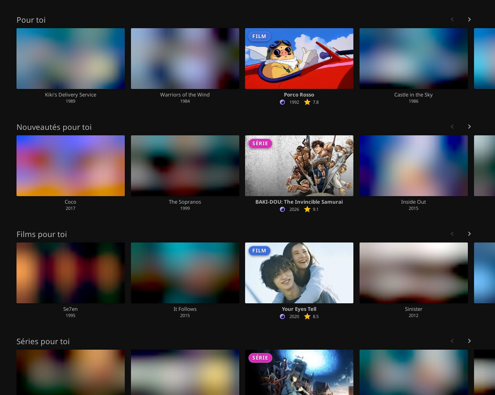
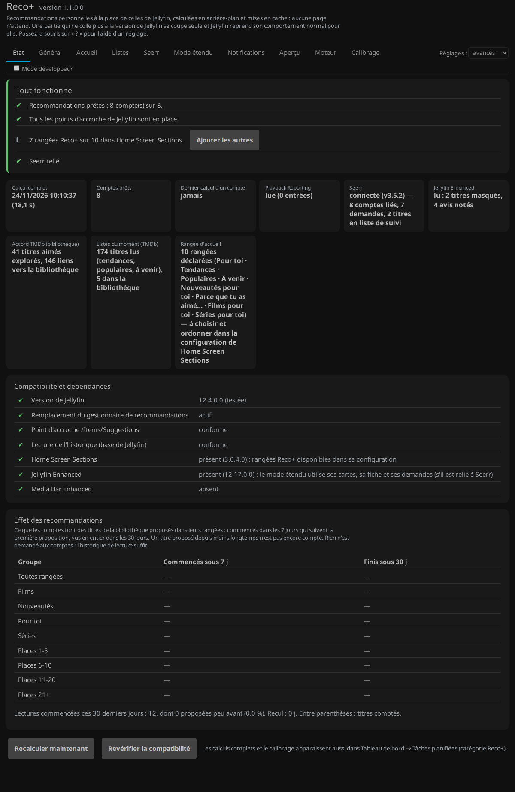
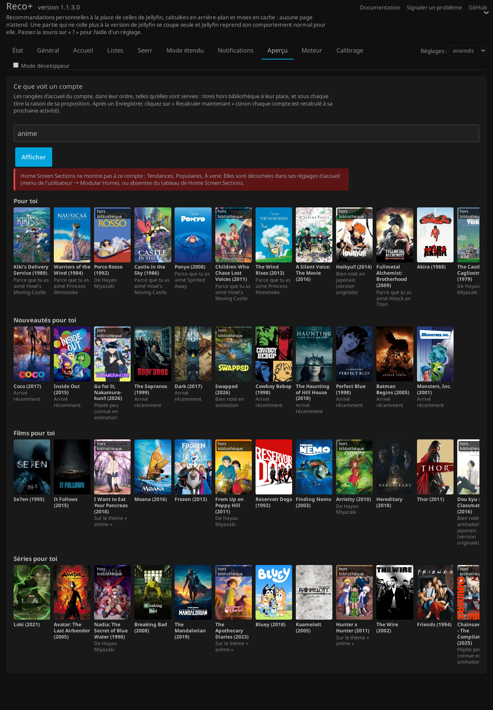
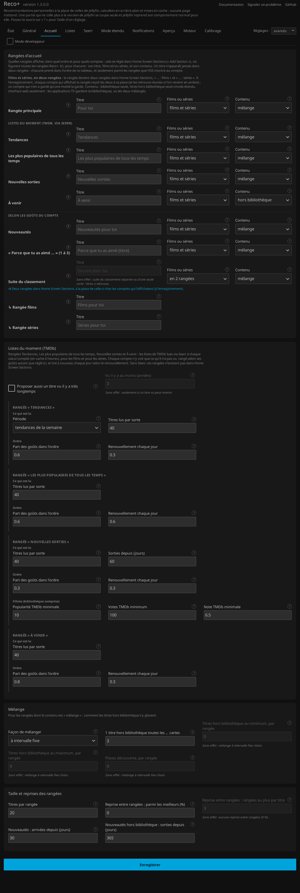
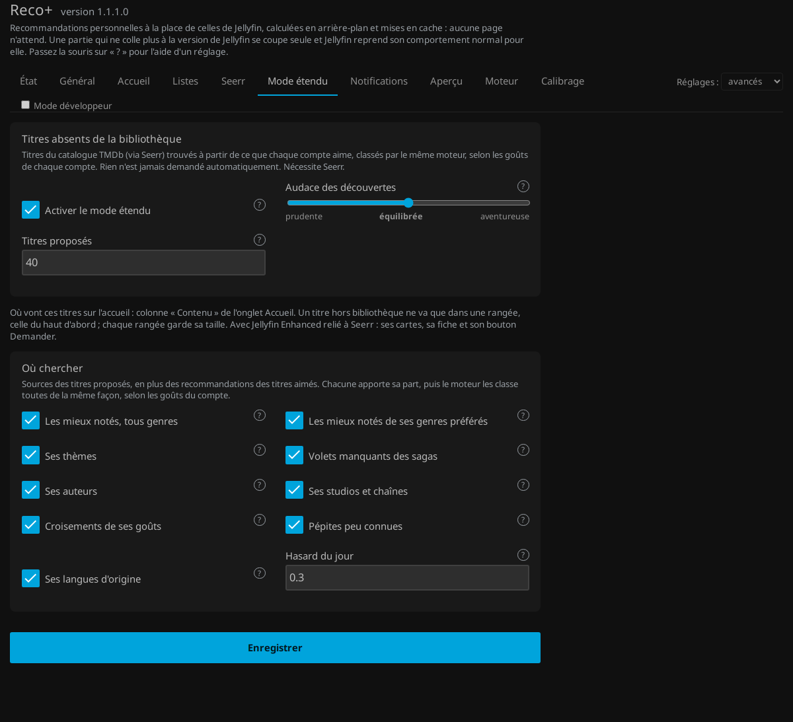

<p align="center"></p>

<h1 align="center">Reco+ — moteur de recommandations pour Jellyfin</h1>

<p align="center"><b>Des recommandations personnalisées pour Jellyfin, façon Netflix, calculées sur tout l'historique de chaque compte.</b></p>

<p align="center">
  <a href="https://github.com/crocodile13/jellyfin-plugin-recoplus/releases/latest"></a>
  <a href="https://github.com/crocodile13/jellyfin-plugin-recoplus/actions/workflows/ci.yml"></a>
  
  <a href="LICENSE"></a>
</p>

<p align="center"><i><a href="README.md">English version</a></i></p>

Les recommandations intégrées à Jellyfin reposent en grande partie sur le hasard. **Reco+ les remplace par des recommandations personnalisées**, calculées pour chaque utilisateur à partir de l'ensemble de son historique : ce qu'il a regardé, apprécié, abandonné ou demandé. Il enrichit également l'accueil de rangées à la manière des plateformes de streaming — « Pour toi », « Parce que tu as aimé … », tendances, nouveautés — et, avec Seerr, peut suggérer des titres absents de votre bibliothèque, à demander en un clic.

- **S'intègre à votre installation** : Reco+ fonctionne seul, mais **Home Screen Sections** (rangées d'accueil) et **Seerr** (Jellyseerr / Overseerr : titres hors bibliothèque, listes du moment) sont recommandés pour l'expérience complète, ainsi que **Jellyfin Enhanced** (avis, titres masqués, cartes de demande). Playback Reporting et Media Bar Enhanced viennent en complément. Toutes ces extensions sont détectées automatiquement.
- **Opérationnel dès l'installation** : les réglages par défaut sont issus de mesures sur un historique réel.
- **Entièrement paramétrable** : chaque facteur de classement, chaque rangée, chaque source et chaque filtre peut être ajusté ou désactivé, ou calibré automatiquement sur votre propre historique.
- **Transparent** : chaque recommandation indique sa raison, et un aperçu montre exactement ce que voit chaque utilisateur.

<p align="center">
  
  <br><sub>Un accueil composé par Reco+ : chaque titre n'apparaît qu'une fois, et la première rangée intègre des titres absents de la bibliothèque (cartes Seerr de Jellyfin Enhanced).</sub>
</p>

## Pourquoi Reco+

| | Jellyfin seul | Avec Reco+ |
|---|---|---|
| **Suggestions** | des titres tirés au hasard | vos titres, classés selon vos goûts |
| **« Parce que vous avez regardé X »** | les 7 derniers films vus | tout l'historique, films et séries, les titres récents comptant davantage |
| **« Plus comme ceci »** | genres communs pour les films, séries au hasard | similarité réelle du contenu, et le volet suivant d'une saga en premier |
| **Accueil** | ajouts récents, reprise de lecture | jusqu'à 10 rangées personnelles, sans aucun doublon |
| **Titres absents de la bibliothèque** | — | suggérés selon vos goûts, demandés en un clic (facultatif, avec Seerr) |

## Fonctionnement en bref

1. **L'historique devient un profil de goûts.** Chaque titre vu, abandonné, noté, mis en favori, masqué ou demandé reçoit un poids. L'ancienneté atténue ce poids, et un abandon pénalise les titres similaires.
2. **Chaque titre non vu reçoit un score** selon sa proximité avec ce profil (genres, mots-clés, réalisation, distribution…) et selon ce que regardent les membres du foyer aux goûts proches.
3. **Un garde-fou préserve la pertinence** : nouveauté, popularité et notes ne départagent que des titres déjà proches de vos goûts. Un titre récent ou populaire sans rapport avec vous n'est jamais mis en avant.
4. **Les rangées sont composées** avec de la diversité, une seule entrée par saga (le premier volet non vu), les nouveautés de ce que vous suivez en tête, et sans doublon d'une rangée à l'autre.

Le calcul s'effectue en arrière-plan : aucune page n'attend. Le fonctionnement détaillé du moteur, formules comprises, est documenté dans le **[wiki](https://github.com/crocodile13/jellyfin-plugin-recoplus/wiki/Accueil-fr)**.

## Installation

### Par le dépôt de plugins (recommandé)

1. Dans **Tableau de bord → Extensions → Dépôts**, ajoutez :
   ```
   https://raw.githubusercontent.com/crocodile13/jellyfin-plugin-recoplus/main/manifest.json
   ```
2. Installez **Reco+** depuis le catalogue.
3. Redémarrez Jellyfin.

Les nouvelles versions sont ensuite installées par la tâche planifiée **Mettre à jour les extensions** de Jellyfin (Tableau de bord → Tâches planifiées) et appliquées au redémarrage suivant.

### À la main

1. Téléchargez `RecoPlus_<version>.zip` depuis les [releases](https://github.com/crocodile13/jellyfin-plugin-recoplus/releases) et vérifiez-le avec le `.sha256` publié.
2. Décompressez-le dans `<config>/plugins/RecoPlus_<version>/`, propriété de l'utilisateur de Jellyfin.
3. Redémarrez Jellyfin.

## Premiers pas

1. Ouvrez **Reco+** depuis le menu du tableau de bord (section Extensions). Les réglages par défaut sont opérationnels dès l'installation.
2. Dans l'onglet **État**, cliquez sur **Recalculer maintenant** pour lancer le premier calcul.
3. Avec Home Screen Sections : cliquez sur **Les ajouter pour moi** dans l'onglet État. Le titre et le contenu de chaque rangée se règlent dans l'onglet **Accueil**.
4. Avec Seerr : renseignez son adresse et sa clé d'API dans l'onglet **Seerr**, cliquez sur **Tester**, puis activez le **Mode étendu** pour recevoir des suggestions hors bibliothèque.
5. Vérifiez le résultat dans l'onglet **Aperçu** : les rangées de chaque utilisateur, en affiches, avec la raison de chaque proposition.

Les réglages se présentent sur trois niveaux — **essentiels** (par défaut), **avancés** et **experts** — sélectionnables à droite des onglets. Une aide s'affiche au survol du **?** placé à côté de chaque réglage.

## Fonctionnalités

- **Partout où Jellyfin recommande** : Suggestions, « Parce que vous avez regardé », « Plus comme ceci » et la Media Bar.
- **Rangées d'accueil** avec [Home Screen Sections](https://github.com/IAmParadox27/jellyfin-plugin-home-sections) : « Pour toi », « Tendances », « Populaires », « À venir », « Nouveautés pour toi », jusqu'à trois « Parce que tu as aimé … », « Films pour toi » et « Séries pour toi ». Chaque rangée peut présenter des films, des séries, les deux, ou être scindée en deux.
- **Tous les signaux exprimés sont pris en compte** : favoris (série, saison ou épisode), notes, avis et titres masqués de Jellyfin Enhanced, demandes et listes de suivi Seerr, titres affichés mais jamais ouverts.
- **Suggestions hors bibliothèque** (mode étendu, facultatif) : des titres du catalogue TMDb choisis d'après vos goûts et classés par le même moteur, avec un curseur d'**audace des découvertes**, de prudente à aventureuse.
- **Recommandations expliquées** : sur la fiche d'un titre ouvert depuis une rangée Reco+, une ligne discrète en donne la raison (« Parce que tu as aimé X », « Suite de X », « Nouveaux épisodes »…).
- **Sécurité** : les droits d'accès et le contrôle parental de Jellyfin s'appliquent à chaque liste ; aucune demande n'est jamais effectuée automatiquement.
- **Efficacité mesurée** : l'onglet État indique ce que les utilisateurs font des titres recommandés (lancés sous 7 jours, terminés sous 30), et le **Calibrage** ajuste le moteur sur votre historique en ne proposant que des réglages dont le gain se confirme.
- **Robuste** : chaque point d'intégration avec Jellyfin est vérifié au démarrage ; une fonction devenue incompatible se désactive d'elle-même et une alerte est émise.
- **Disponible en français, anglais, allemand et espagnol**, selon la langue de chaque utilisateur.

## Captures d'écran

<table>
  <tr>
    <td width="50%" valign="top"><a href="assets/screenshots/config-status-fr.png"></a><br><sub><b>État</b> — résumé de santé, mise en route, vérifications de compatibilité.</sub></td>
    <td width="50%" valign="top"><a href="assets/screenshots/config-preview-fr.png"></a><br><sub><b>Aperçu</b> — ce que voit chaque utilisateur, avec la raison de chaque titre.</sub></td>
  </tr>
  <tr>
    <td width="50%" valign="top"><a href="assets/screenshots/config-home-fr.png"></a><br><sub><b>Accueil</b> — titre, films/séries et contenu de chaque rangée.</sub></td>
    <td width="50%" valign="top"><a href="assets/screenshots/config-extended-fr.png"></a><br><sub><b>Mode étendu</b> — titres hors bibliothèque et audace des découvertes.</sub></td>
  </tr>
</table>

<sub>Prises automatiquement sur le serveur de test après chaque publication : comptes et historiques simulés. Chaque onglet de la configuration, en français et en anglais, se trouve dans [assets/screenshots](assets/screenshots).</sub>

## Prérequis

- **Jellyfin 12.2 à 12.4** (les autres versions sont détectées et chaque point d'accroche est vérifié, mais elles ne sont pas testées).
- Extensions : aucune n'est indispensable, mais les trois premières sont recommandées pour l'expérience complète.

| Extension / service | | Apport |
|---|---|---|
| [Home Screen Sections](https://github.com/IAmParadox27/jellyfin-plugin-home-sections) | recommandé | les rangées d'accueil ; il détermine quelles rangées chaque utilisateur voit, et dans quel ordre |
| [Seerr](https://github.com/seerr-team/seerr) (Jellyseerr / Overseerr) | recommandé | demandes et listes de suivi prises en compte, rangées tendances / populaires / à venir, suggestions hors bibliothèque (mode étendu) |
| [Jellyfin Enhanced](https://github.com/n00bcodr/Jellyfin-Enhanced) | recommandé | avis et titres masqués ; ses cartes et son bouton *Demander* pour les titres hors bibliothèque |
| [Playback Reporting](https://github.com/jellyfin/jellyfin-plugin-playbackreporting) | complément | dates de premier visionnage précises, utiles au calibrage |
| [Media Bar Enhanced](https://github.com/IAmParadox27/jellyfin-plugin-media-bar) | complément | affiche les recommandations de Reco+ lorsque son option « Personalized Recommendations » est activée |

LocalRecs, s'il est installé, produit des recommandations en double : il est conseillé de le désinstaller.

## Questions fréquentes

**Pourquoi les recommandations de Jellyfin semblent-elles aléatoires ?** `/Items/Suggestions` renvoie des titres au hasard, « Parce que vous avez regardé » ne considère que les derniers films vus, et « Plus comme ceci » propose des séries au hasard partageant un genre. Reco+ remplace ces trois mécanismes.

**Peut-on obtenir un accueil comparable à celui des plateformes de streaming ?** Oui, avec Home Screen Sections : Reco+ fournit les rangées, personnalisées pour chaque utilisateur.

**Jellyfin peut-il recommander des films absents de la bibliothèque ?** Oui, avec le mode étendu et Seerr. Aucune demande n'est effectuée automatiquement.

**Convient-il à un serveur familial ?** Oui : chaque utilisateur dispose de ses propres listes, les accès aux bibliothèques et le contrôle parental sont respectés, et les comptes invités ou enfants peuvent être exclus.

**Pourquoi tel titre m'est-il proposé ?** Ouvrez-le depuis une rangée Reco+ : la raison s'affiche sous son nom. Les administrateurs consultent les rangées de chaque utilisateur, raisons comprises, dans l'onglet Aperçu.

**Comment ne plus voir un titre ?** Masquez-le avec Jellyfin Enhanced (« pas intéressé ») ou attribuez-lui une mauvaise note : il disparaît, et les titres similaires reculent.

## Vie privée

Rien ne quitte le serveur, sauf les appels à **votre** instance Seerr quand vous la configurez et, en mode étendu, les affiches chargées par le client web depuis `image.tmdb.org`. Les titres montrés sans être ouverts restent sur le serveur (un an au plus) et ne jouent que sur le classement de ce compte ; la liste des titres proposés à chaque compte (pour la mesure de l'onglet État) reste elle aussi sur le serveur et s'oublie 120 jours après la dernière proposition d'un titre.

## Documentation

- **[Wiki : fonctionnement de Reco+](https://github.com/crocodile13/jellyfin-plugin-recoplus/wiki/Accueil-fr)** — données utilisées, calcul du score, rangées, mode étendu, calibrage, mesures et réglages.
- [Historique des versions](CHANGELOG.md) (en anglais).

## Développement

```
src/RecoPlus.Engine/          le moteur (.NET pur, sans dépendance à Jellyfin)
src/Jellyfin.Plugin.RecoPlus/ intégration Jellyfin, Seerr, API, page et script web
tests/RecoPlus.Tests/         tests unitaires + tests de parité avec le prototype Python
prototype/                    moteur de référence en Python et évaluation hors ligne qui a servi à fixer les réglages
tools/reco-export/            export pseudonymisé, en lecture seule, de l'historique d'un serveur, pour l'évaluation
```

Pour compiler et tester :

```bash
./build.sh
# ou, sans SDK .NET local :
docker run --rm --user "$(id -u):$(id -g)" -e HOME=/tmp -v "$PWD:/src" -w /src mcr.microsoft.com/dotnet/sdk:10.0 ./build.sh
```

Le moteur C# est vérifié pour reproduire exactement le prototype Python :
- scores à 1e-9 près et listes identiques, sur un jeu synthétique que la CI régénère à chaque exécution (`prototype/golden.py`) ;
- pendant le développement, 0 écart sur les 126 cas d'évaluation des données réelles.

La CI compile et teste à chaque push. Quand une nouvelle version apparaît dans `manifest.json`, une release est publiée et le manifeste est complété automatiquement.

## Limites

- Construit et testé pour Jellyfin 12.2 à 12.4 uniquement.
- Les valeurs par défaut ont été choisies sur l'historique réel d'un petit foyer, puis vérifiées sur des données synthétiques (bibliothèque de vrais titres, 30 comptes simulés). Chaque serveur est différent : le Calibrage les ajuste à votre propre historique.
- Les titres hors bibliothèque sont ajoutés par un script du client web ; les applications TV et mobiles ne reçoivent que les recommandations de la bibliothèque.

## Développement assisté par IA

Reco+ est développé avec l'aide d'un assistant d'IA (Claude, d'Anthropic), qui écrit l'essentiel du code sous la direction du mainteneur. Le mainteneur décide de ce qui est construit, relit chaque modification et la valide avant sa publication : tests unitaires et de parité dans la CI, test d'intégration sur de vrais serveurs Jellyfin à chaque pull request, et mesures sur des historiques de lecture pour tout ce qui touche aux recommandations.

## Contribuer

Les contributions sont les bienvenues : signalements de bugs, idées, code. Le guide [CONTRIBUTING.md](CONTRIBUTING.md) décrit la marche à suivre.

**Les historiques de lecture sont particulièrement précieux.** Le moteur n'a pu être évalué que sur un petit foyer réel ; des données plus nombreuses et plus variées permettraient d'affiner ses réglages par défaut pour tout le monde. Si votre serveur a beaucoup d'utilisateurs ou un long historique, un jeu de données anonymisé serait d'une grande aide. L'export intégré (onglet Calibrage, mode développeur) ou [`tools/reco-export`](tools/reco-export) le produisent en lecture seule, comptes renommés (u01, u02…), sans nom ni identifiant. Ouvrez une issue pour convenir d'un moyen d'envoi : ne publiez jamais ces données directement.

## Licence

[GPL-3.0](LICENSE).
