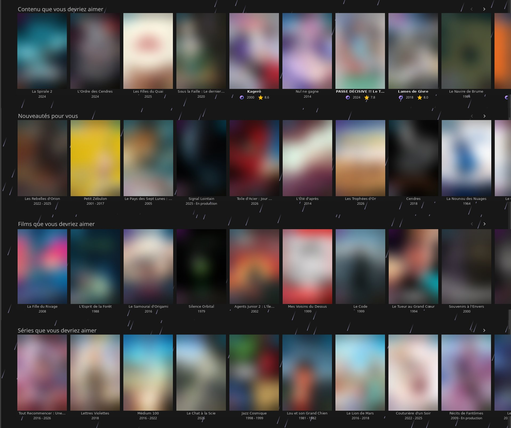
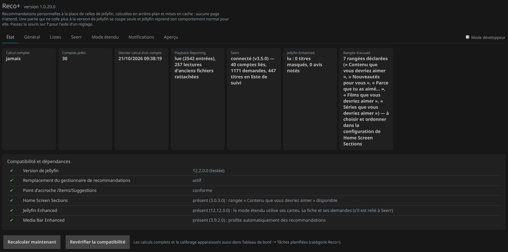
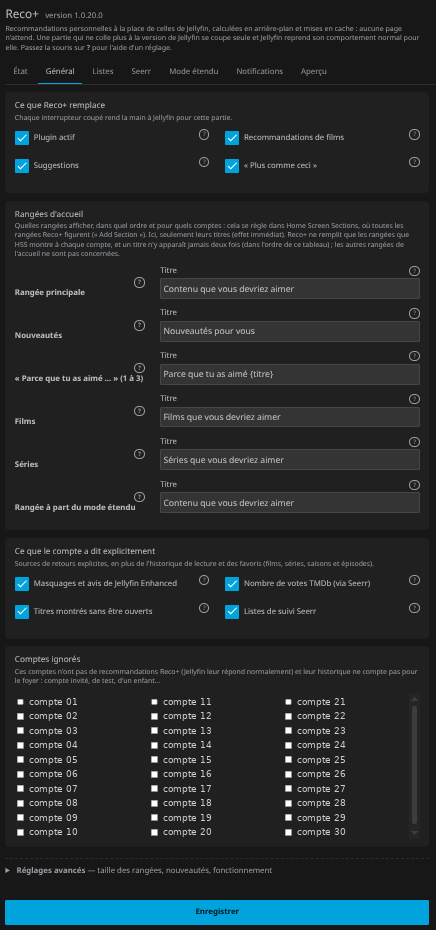
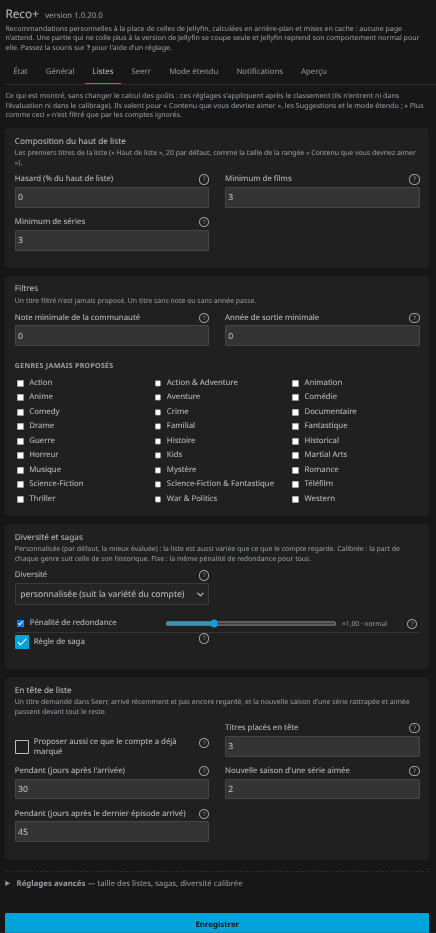
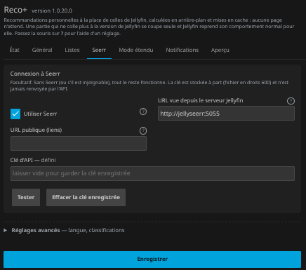
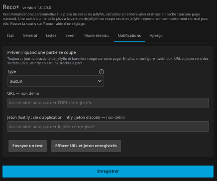

<p align="center"></p>

<h1 align="center">Reco+ — recommendation engine plugin for Jellyfin</h1>

<p align="center"><b>Personalized, Netflix-style recommendations for Jellyfin, computed from each user's whole watch history.</b></p>

<p align="center">
  <a href="https://github.com/crocodile13/jellyfin-plugin-recoplus/releases/latest"></a>
  <a href="https://github.com/crocodile13/jellyfin-plugin-recoplus/actions/workflows/ci.yml"></a>
  
  <a href="LICENSE"></a>
</p>

<p align="center"><i><a href="README.fr.md">Version française</a></i></p>

Reco+ is a Jellyfin plugin that replaces the built-in recommendations — Suggestions, "Because you watched", "More like this" (similar items) — with lists ranked for each user. It adds personalized home screen rows ("For you", "Because you liked …") through Home Screen Sections, and can recommend movies and TV shows you don't have yet through Seerr (Jellyseerr / Overseerr), with a one-click *Request* button. Everything is computed in the background and cached: no page ever waits.

## Features

- **Better recommendations everywhere Jellyfin shows them**: `/Items/Suggestions` (random in Jellyfin), `/Movies/Recommendations` ("Because you liked X" from the whole history, not just the last 7 movies), "More like this" for movies and series (random series in Jellyfin).
- **Home rows** with [Home Screen Sections](https://github.com/IAmParadox27/jellyfin-plugin-home-sections): "For you", "New for you", up to three "Because you liked …", "Movies for you", "Series for you" — a title never appears twice.
- **Uses everything the account told you**: whole history with decay, abandoned titles, favourites (series, seasons, episodes), ratings and Jellyfin Enhanced reviews and hidden titles, Seerr requests and watchlist, titles shown but never opened.
- **Extended mode** (optional, needs Seerr): titles outside the library in the home rows of your choice — library only, Seerr only or mixed, per row — with Jellyfin Enhanced's cards and *Request* button.
- **Safe by design**: a guard rail keeps new or popular titles from being pushed to accounts they don't fit; Jellyfin's access rules and parental control apply to every list; nothing is ever requested automatically.
- **Calibration** on your own history, with cross-validation by account: settings are only proposed when they really generalize, and nothing is applied without your click.
- **Self-protecting**: every Jellyfin hook is checked at start-up; a part that no longer fits switches itself off and Jellyfin's normal behaviour comes back, with an alert (activity log, banner, optional webhook).
- **English and French** interface, following each person's Jellyfin language.

## Screenshots

<p align="center">
  
  <br><sub>Home screen with Home Screen Sections: four Reco+ rows, a title never repeated across them. The first row mixes in titles outside the library (Seerr cards from Jellyfin Enhanced).</sub>
</p>

<p align="center">
  
  <br><sub>Status tab: what was read, and the compatibility checks run at start-up.</sub>
</p>

<table>
  <tr>
    <td width="50%" valign="top"><br><sub><b>General</b> — what Reco+ replaces, row titles, explicit feedback, ignored accounts.</sub></td>
    <td width="50%" valign="top"><br><sub><b>Lists</b> — what is shown: randomness, minimums, filters, diversity, sagas, pinned titles.</sub></td>
  </tr>
  <tr>
    <td width="50%" valign="top"><br><sub><b>Seerr</b> — connection test; the key is stored apart and never sent back.</sub></td>
    <td width="50%" valign="top"><br><sub><b>Notifications</b> — webhook when a part switches itself off.</sub></td>
  </tr>
</table>

<sub>Interface available in English and French (screenshots in French). Screenshots from version 1.0.20 on a real server: account names replaced, artwork blurred, titles made up.</sub>

<sub>PS: the rain is not a Reco+ feature. It is a personal whim of the author's "production" instance, where these screenshots were taken. The plugin recommends films; it does not do the weather.</sub>

## Requirements

- **Jellyfin 12.2** (other versions are detected and each hook is checked, but they are not tested).
- Optional: [Home Screen Sections](https://github.com/IAmParadox27/jellyfin-plugin-home-sections) for home rows, [Jellyfin Enhanced](https://github.com/n00bcodr/Jellyfin-Enhanced) for reviews, hidden titles and Seerr cards, [Playback Reporting](https://github.com/jellyfin/jellyfin-plugin-playbackreporting) for precise first-play dates, and a [Seerr](https://github.com/seerr-team/seerr) instance for requests and extended mode.

## Installation

### From the plugin repository (recommended)

1. In **Dashboard → Plugins → Repositories**, add:
   ```
   https://raw.githubusercontent.com/crocodile13/jellyfin-plugin-recoplus/main/manifest.json
   ```
2. Install **Reco+** from the catalogue.
3. Restart Jellyfin.

### Manually

1. Download `RecoPlus_<version>.zip` from the [releases](https://github.com/crocodile13/jellyfin-plugin-recoplus/releases) and check it against the published `.sha256`.
2. Extract it into `<config>/plugins/RecoPlus_<version>/`, owned by the Jellyfin user.
3. Restart Jellyfin.

## Getting started

1. Open **Reco+** in the Plugins section of the dashboard menu (or **Dashboard → Plugins → Reco+**). The defaults are the evaluated ones: Reco+ works as soon as it is installed.
2. Click **Recompute now** on the Status tab (otherwise each account is computed at its next activity).
3. With Home Screen Sections: add the Reco+ rows you want in its settings ("Add Section"); their titles are set on the General tab.
4. With Seerr: enter its URL and API key on the Seerr tab, click **Test**, then enable extended mode if you want titles outside the library.
5. Check what an account gets on the **Preview** tab.

Basic settings are visible at once; advanced ones are folded away or in the **Engine** and **Calibration** tabs; diagnostic tools (log, calibration data export) are in **developer mode**. Hover over **?** next to any setting for its help.

## FAQ

**Why are Jellyfin's recommendations so random?** In Jellyfin, `/Items/Suggestions` returns random items, "Because you watched" only looks at the last few movies, and "More like this" picks random series sharing a genre. Reco+ replaces all three with a ranking built from each user's whole history.

**Can I get a Netflix-like home screen in Jellyfin?** Yes, with [Home Screen Sections](https://github.com/IAmParadox27/jellyfin-plugin-home-sections): Reco+ provides "For you", "New for you", "Because you liked …", "Movies for you" and "Series for you" rows, personalized per user.

**Can Jellyfin recommend movies I don't have yet?** Yes, with extended mode and a Seerr (Jellyseerr or Overseerr) instance: titles from the TMDb catalogue are suggested in the home rows, ranked by the same engine, and can be requested in one click. Nothing is requested automatically.

**Does it work for several users or a family server?** Yes: each user gets their own lists, Jellyfin's library access and parental controls are respected, and guest or child accounts can be ignored.

**How is it different from other recommendation plugins?** It uses explicit feedback (ratings, favourites, hidden titles, requests, abandoned titles), content similarity and collaborative filtering ("watched together"), keeps popular or new titles from being pushed to users they don't fit, and can calibrate itself on your own history.

## Optional integrations

| Plugin / service | If present | If absent |
|---|---|---|
| Home Screen Sections | every Reco+ row is listed among its sections: HSS decides which ones are shown, in which order and to whom (Reco+ only sets their titles, without a restart, and fills only the rows HSS shows to each account); "Because you liked X" titles are per account in the web client ("Because you liked…" elsewhere); HSS shows plugin rows in landscape, and titles outside the library take the same shape | no home row; everything else works |
| Jellyfin Enhanced | extended mode uses its cards, detail modal and *Request* button, with the live Seerr status (if it is linked to Seerr); Reco+ waits a few seconds for it on load and swaps its own cards for JE's as soon as it is ready | Reco+ cards, opening the Seerr page, with Reco+'s own *Request* button |
| Media Bar Enhanced | with its "Personalized Recommendations" option on, shows Reco+ recommendations (it calls the replaced endpoints; library titles only) | — |
| Playback Reporting | precise first-play dates for calibration | calibration is less precise; Reco+ also records first plays itself from install time |
| Seerr (formerly Jellyseerr) | requests and watchlist as a signal, extended mode | all of this is off; the rest works |
| LocalRecs | flagged as a duplicate | — |

## Privacy

Nothing leaves the server, except calls to **your** Seerr instance when you configure it and, in extended mode, posters loaded by the web client from `image.tmdb.org`. Titles shown but never opened stay on the server (one year at most) and only affect that account's ranking.

## Documentation

- [How Reco+ works](docs/how-it-works.md): what the engine takes into account, measurements, safety, every setting, calibration.

## Development

```
src/RecoPlus.Engine/         the engine (pure .NET, no Jellyfin dependency)
src/Jellyfin.Plugin.RecoPlus/ Jellyfin integration, Seerr, API, web page and script
tests/RecoPlus.Tests/        unit tests + parity tests against the Python prototype
prototype/                   Python reference engine and the offline evaluation used to choose the defaults
tools/reco-export/           read-only, pseudonymised export of a server's history for offline evaluation
```

To build and test:

```bash
./build.sh
# or, without a local .NET SDK:
docker run --rm --user "$(id -u):$(id -g)" -e HOME=/tmp -v "$PWD:/src" -w /src mcr.microsoft.com/dotnet/sdk:10.0 ./build.sh
```

The C# engine is checked to reproduce the Python prototype exactly:
- scores to 1e-9 and identical lists, on a synthetic dataset regenerated by CI on every run (`prototype/golden.py`);
- 0 differences over 126 evaluation cases on real data, during development.

CI builds and tests on every push. When `manifest.json` gets a new version, a release is published and the manifest is filled in automatically.

## Limitations

- Built and tested for Jellyfin 12.2 only.
- The defaults were chosen on a single, small household: use Calibration on yours.
- Titles outside the library are added by a script in the web client; TV and mobile apps get library recommendations only.

## License

[GPL-3.0](LICENSE).
