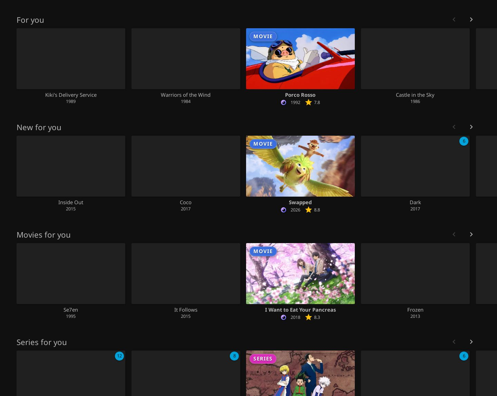
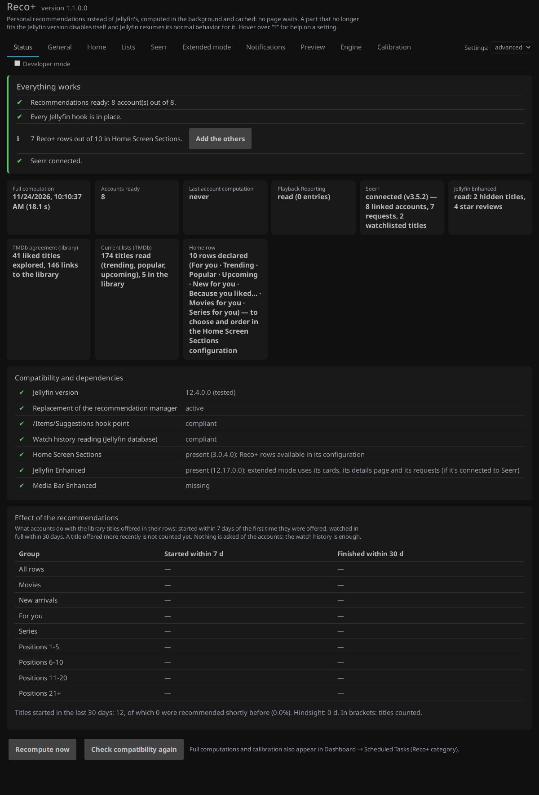
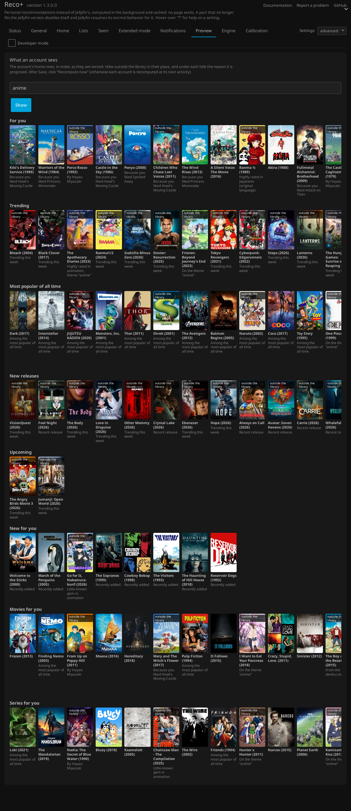
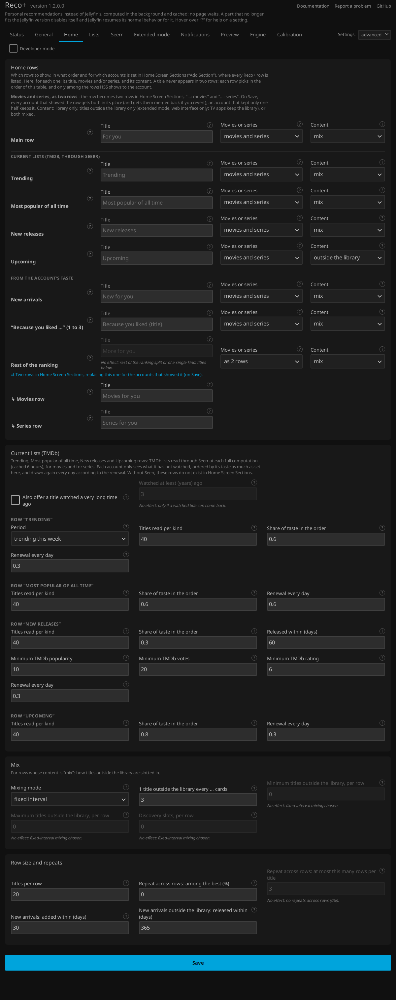
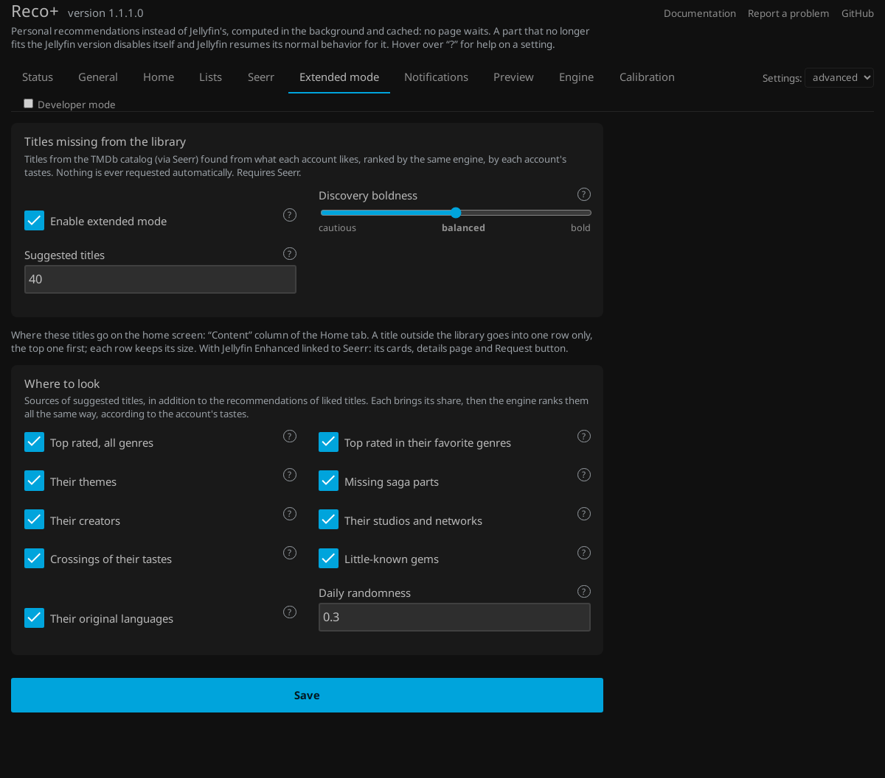

<p align="center"></p>

<h1 align="center">Reco+ — recommendation engine plugin for Jellyfin</h1>

<p align="center"><b>Personalized, Netflix-style recommendations for Jellyfin, computed from each user's whole watch history.</b></p>

<p align="center">
  <a href="https://github.com/crocodile13/jellyfin-plugin-recoplus/releases/latest"></a>
  <a href="https://github.com/crocodile13/jellyfin-plugin-recoplus/actions/workflows/ci.yml"></a>
  
  <a href="LICENSE"></a>
</p>

<p align="center"><i><a href="README.fr.md">Version française</a></i></p>

Jellyfin's built-in recommendations rely largely on chance. **Reco+ replaces them with personalized recommendations**, computed for each user from their entire history: what they watched, enjoyed, abandoned or requested. It also brings streaming-style rows to the home screen — "For you", "Because you liked …", trending, new arrivals — and, with Seerr, can suggest titles missing from your library, ready to request in one click.

- **Fits your setup**: Reco+ works on its own, but **Home Screen Sections** (home rows) and **Seerr** (Jellyseerr / Overseerr: titles beyond the library, current lists) are recommended for the full experience, as is **Jellyfin Enhanced** (reviews, hidden titles, request cards). Playback Reporting and Media Bar Enhanced add to it. All of them are detected automatically.
- **Ready out of the box**: the default settings come from measurements on a real watch history.
- **Fully configurable**: every ranking factor, row, source and filter can be adjusted or switched off, or calibrated automatically on your own history.
- **Transparent**: every recommendation states its reason, and a preview shows exactly what each user sees.

<p align="center">
  
  <br><sub>A home screen built by Reco+: each title appears only once, and the first row includes titles missing from the library (Seerr cards from Jellyfin Enhanced).</sub>
</p>

## Why Reco+

| | Jellyfin alone | With Reco+ |
|---|---|---|
| **Suggestions** | randomly picked titles | your titles, ranked by your tastes |
| **"Because you watched X"** | the last 7 movies watched | the whole history, movies and series, with recent titles weighing more |
| **"More like this"** | shared genres for movies, random series | real content similarity, with the next part of a saga first |
| **Home screen** | recently added, continue watching | up to 10 personal rows, with no duplicates |
| **Titles missing from the library** | — | suggested from your tastes, requested in one click (optional, with Seerr) |

## How it works

1. **The history becomes a taste profile.** Every title watched, abandoned, rated, favourited, hidden or requested gets a weight. Older activity weighs less, and an abandon counts against similar titles.
2. **Every unseen title gets a score** from how close it is to that profile (genres, keywords, direction, cast…) and from what household members with similar tastes watch.
3. **A guard rail keeps it relevant**: freshness, popularity and ratings only break ties between titles that already match your tastes. A new or popular title unrelated to you is never pushed.
4. **The rows are built** with diversity, a single entry per saga (the first part not yet seen), new releases of what you follow first, and no duplicates from one row to the next.

Everything is computed in the background: no page ever waits. The engine is documented in detail, formulas included, in the **[wiki](https://github.com/crocodile13/jellyfin-plugin-recoplus/wiki)**.

## Installation

### From the plugin repository (recommended)

1. In **Dashboard → Plugins → Repositories**, add:
   ```
   https://raw.githubusercontent.com/crocodile13/jellyfin-plugin-recoplus/main/manifest.json
   ```
2. Install **Reco+** from the catalogue.
3. Restart Jellyfin.

New versions are then installed by Jellyfin's **Update Plugins** scheduled task (Dashboard → Scheduled tasks) and applied at the next restart.

### Manually

1. Download `RecoPlus_<version>.zip` from the [releases](https://github.com/crocodile13/jellyfin-plugin-recoplus/releases) and check it against the published `.sha256`.
2. Extract it into `<config>/plugins/RecoPlus_<version>/`, owned by the Jellyfin user.
3. Restart Jellyfin.

## First steps

1. Open **Reco+** from the dashboard menu (Plugins section). The default settings work as soon as it is installed.
2. On the **Status** tab, click **Recompute now** to run the first computation.
3. With Home Screen Sections: click **Add them for me** on the Status tab. Each row's title and content are set on the **Home** tab.
4. With Seerr: enter its address and API key on the **Seerr** tab, click **Test**, then turn on **Extended mode** to receive suggestions from outside the library.
5. Check the result on the **Preview** tab: each user's rows as posters, with the reason for every suggestion.

Settings come in three levels — **essential** (default), **advanced** and **expert** — selectable at the right of the tabs. Help appears when hovering over the **?** next to each setting.

## Features

- **Everywhere Jellyfin recommends**: Suggestions, "Because you watched", "More like this" and the Media Bar.
- **Home rows** with [Home Screen Sections](https://github.com/IAmParadox27/jellyfin-plugin-home-sections): "For you", "Trending", "Most popular of all time", "New releases" (released lately in your country), "Upcoming", "New for you", up to three "Because you liked …", "Movies for you" and "Series for you". Each row can show movies, series, both, or be split in two.
- **Every signal counts**: favourites (series, season or episode), ratings, Jellyfin Enhanced reviews and hidden titles, Seerr requests and watchlists, titles shown but never opened.
- **Suggestions beyond the library** (extended mode, optional): titles from the TMDb catalogue chosen from your tastes and ranked by the same engine, with a **discovery boldness** slider from cautious to bold.
- **Explained recommendations**: on the page of a title opened from a Reco+ row, a discreet line gives the reason ("Because you liked X", "Sequel to X", "New episodes"…).
- **Safe**: Jellyfin's access rules and parental control apply to every list; nothing is ever requested automatically.
- **Measured effectiveness**: the Status tab shows what users do with recommended titles (started within 7 days, finished within 30), and **Calibration** tunes the engine on your history, only proposing settings whose gain holds up.
- **Robust**: every Jellyfin hook is checked at start-up; a feature that becomes incompatible disables itself and an alert is raised.
- **Available in English, French, German and Spanish**, following each user's language.

## Screenshots

<table>
  <tr>
    <td width="50%" valign="top"><a href="assets/screenshots/config-status-en.png"></a><br><sub><b>Status</b> — health summary, start-up checklist, compatibility checks.</sub></td>
    <td width="50%" valign="top"><a href="assets/screenshots/config-preview-en.png"></a><br><sub><b>Preview</b> — what each user sees, with the reason for every title.</sub></td>
  </tr>
  <tr>
    <td width="50%" valign="top"><a href="assets/screenshots/config-home-en.png"></a><br><sub><b>Home</b> — title, movies/series and content of every row.</sub></td>
    <td width="50%" valign="top"><a href="assets/screenshots/config-extended-en.png"></a><br><sub><b>Extended mode</b> — titles outside the library and discovery boldness.</sub></td>
  </tr>
</table>

<sub>Taken automatically on the integration server after each release: simulated accounts and watch histories. Every settings tab, in English and French, is in [assets/screenshots](assets/screenshots).</sub>

## Requirements

- **Jellyfin 12.2 to 12.4** (other versions are detected and each hook is checked, but they are not tested).
- Extensions: none is required, but the first three are recommended for the full experience.

| Extension / service | | Adds |
|---|---|---|
| [Home Screen Sections](https://github.com/IAmParadox27/jellyfin-plugin-home-sections) | recommended | the home rows; it decides which rows each user sees, and in which order |
| [Seerr](https://github.com/seerr-team/seerr) (Jellyseerr / Overseerr) | recommended | requests and watchlists taken into account, trending / most popular / new releases / upcoming rows, suggestions beyond the library (extended mode) |
| [Jellyfin Enhanced](https://github.com/n00bcodr/Jellyfin-Enhanced) | recommended | reviews and hidden titles; its cards and *Request* button for titles outside the library |
| [Playback Reporting](https://github.com/jellyfin/jellyfin-plugin-playbackreporting) | add-on | precise first-play dates, useful for calibration |
| [Media Bar Enhanced](https://github.com/IAmParadox27/jellyfin-plugin-media-bar) | add-on | shows Reco+ recommendations when its "Personalized Recommendations" option is on |

LocalRecs, if installed, produces duplicate recommendations: uninstalling it is advised.

## FAQ

**Why do Jellyfin's recommendations feel random?** `/Items/Suggestions` returns random titles, "Because you watched" only considers the last movies watched, and "More like this" offers random series sharing a genre. Reco+ replaces all three.

**Can Jellyfin have a streaming-style home screen?** Yes, with Home Screen Sections: Reco+ provides the rows, personalized for each user.

**Can Jellyfin recommend movies that are not in the library?** Yes, with extended mode and Seerr. Nothing is ever requested automatically.

**Is it suited to a family server?** Yes: each user has their own lists, library access and parental controls are respected, and guest or child accounts can be excluded.

**Why is this title suggested to me?** Open it from a Reco+ row: the reason appears under its name. Administrators can review every user's rows, reasons included, on the Preview tab.

**How do I stop seeing a title?** Hide it with Jellyfin Enhanced ("not interested") or give it a low rating: it disappears, and similar titles move down.

## Privacy

Nothing leaves the server, except calls to **your** Seerr instance when you configure it and, in extended mode, posters loaded by the web client from `image.tmdb.org`. Titles shown but never opened stay on the server (one year at most) and only affect that account's ranking; the list of titles offered to each account (for the Status tab's measurement) stays on the server too and is forgotten 120 days after a title was last offered.

## Documentation

- **[Wiki: how Reco+ works](https://github.com/crocodile13/jellyfin-plugin-recoplus/wiki)** — data used, score computation, rows, extended mode, calibration, measurements and settings.
- [Changelog](CHANGELOG.md).

## Development

```
src/RecoPlus.Engine/         the engine (pure .NET, no Jellyfin dependency)
src/Jellyfin.Plugin.RecoPlus/ Jellyfin integration, Seerr, API, web page and script
tests/RecoPlus.Tests/        unit tests + parity tests against the Python prototype
prototype/                   Python reference engine and the offline evaluation used to choose the defaults
tools/reco-export/           read-only, pseudonymised export of a server's history for offline evaluation
```

To build and test:

```bash
./build.sh
# or, without a local .NET SDK:
docker run --rm --user "$(id -u):$(id -g)" -e HOME=/tmp -v "$PWD:/src" -w /src mcr.microsoft.com/dotnet/sdk:10.0 ./build.sh
```

The C# engine is checked to reproduce the Python prototype exactly:
- scores to 1e-9 and identical lists, on a synthetic dataset regenerated by CI on every run (`prototype/golden.py`);
- 0 differences over 126 evaluation cases on real data, during development.

CI builds and tests on every push. When `manifest.json` gets a new version, a release is published and the manifest is filled in automatically.

## Limitations

- Built and tested for Jellyfin 12.2 to 12.4 only.
- The defaults were chosen on the real history of a small household, then checked on synthetic data (a library of real titles, 30 simulated accounts). Every server is different: Calibration adjusts them to your own history.
- Titles you don't have are added by a script in the web client; TV and mobile apps get library recommendations only.

## AI-assisted development

I develop Reco+ with an AI assistant (Claude, by Anthropic), which writes most of the code. I decide what gets built and review every change before it ships. Each change goes through automated tests and a test on real Jellyfin servers; anything that affects the recommendations is also measured on watch histories.

## Contributing

Contributions are welcome: bug reports, ideas, code. [CONTRIBUTING.md](CONTRIBUTING.md) explains how to get started.

**Watch histories are especially valuable.** The engine could only be evaluated on one small real household; more and more varied data would refine its defaults for everyone. If your server has many users or a long history, an anonymized dataset would help a great deal. The built-in export (Calibration tab, developer mode) or [`tools/reco-export`](tools/reco-export) produce one read-only, with accounts renamed (u01, u02…) and no names or identifiers. Please open an issue to arrange how to share it — never post the data publicly.

[GPL-3.0](LICENSE).
